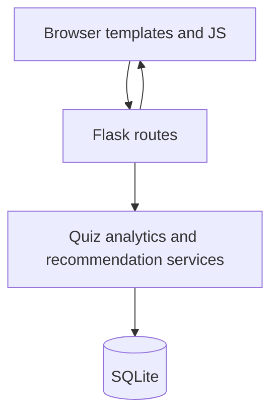

# EduBridge AI

**Team:** AAAlpha  
**Hackathon:** HackOverflow 10.0  
**Team lead:** Prashanth R  
**Team member:** Mahesh

EduBridge AI is a local web application that helps students find knowledge gaps, practice weaker topics, and follow a study plan built from their own quiz results.

The workspace did not include official HackOverflow 10.0 theme documents. This project is implemented as a practical education tool rather than a claim about a specific published theme.

## Problem statement

Students often cannot tell which topics are actually weak, and generic learning paths ignore individual quiz performance, available study time, and career-oriented tracks. Searching for resources is disconnected from those results.

## Proposed solution

EduBridge AI stores a learning goal, serves a diagnostic multiple-choice quiz, scores answers by topic, labels skill-gap bands with explicit rules, recommends public documentation, and writes a day-by-day study plan to SQLite. Dashboard and progress views read those stored records.

## Key features

- Landing page that explains the workflow without fabricated testimonials or statistics
- Learning goal setup with frontend and backend validation
- Topic-based diagnostic quizzes with navigation, confirmation, and post-submit review
- Skill-gap analysis using 50% / 75% score bands
- Rule-based recommendation engine that generates a replaceable study plan
- Resource explorer with search and filters, using public documentation URLs
- Dashboard and analytics from SQLite, including empty states
- Local demo profile and preference editing
- Automated pytest coverage for scoring, plans, resources, and persistence

## Target users

College students and beginners preparing for technical skills in Python, Java, web development, data structures, or data analysis.

## Technology stack

- HTML5, CSS3, JavaScript
- Python and Flask
- SQLite
- Chart.js loaded from a CDN when the network allows it
- Lucide icons from a CDN
- pytest and Flask’s test client

No paid API keys are required for the core application.

## System architecture



## Main application workflow

Student → set learning goal → take diagnostic quiz → review topic analysis → generate study plan → practice with linked resources → mark tasks complete → retake quiz and compare stored scores.

## Recommendation engine

The MVP engine is **rule-based and deterministic**. It is not a trained machine-learning model.

It validates preferences, computes topic scores, ranks weaker topics first, selects catalog resources, and allocates about 60% of days to topics below 75%, with remaining days used for mixed revision. Regenerating a plan deletes the previous plan for the demo student so tasks are not duplicated.

A later ML model could learn which resources or durations correlate with score gains after enough labeled history exists.

## Database schema overview

| Table | Role |
| --- | --- |
| `students` | Local demo profile |
| `learning_preferences` | Track, level, daily minutes, target days |
| `quiz_questions` | Question bank and answer keys |
| `quiz_attempts` | Overall scores |
| `quiz_attempt_answers` | Per-question submissions |
| `topic_results` | Topic scores and bands |
| `learning_resources` | Catalog of public URLs |
| `study_plans` | Generated plan metadata |
| `study_tasks` | Daily tasks and completion flags |

## HTTP routes

See `docs/API.md` for JSON details. Implemented HTML routes:

- `GET /` landing
- `GET /dashboard`
- `GET|POST /goals`
- `GET /quiz`
- `GET /analysis` and `GET /analysis/<attempt_id>`
- `GET /study-plan`
- `GET /resources`
- `GET /progress`
- `GET|POST /profile`
- `GET /health`

JSON:

- `GET /api/health`
- `GET /api/quiz`
- `POST /api/quiz/submit`
- `POST /api/goals`
- `POST /api/study-plan/generate`
- `POST /api/tasks/<id>/complete`
- `GET /api/resources`
- `GET /api/progress`
- `GET /api/dashboard`
- `POST /api/profile`

## Prerequisites

- Windows 10 or later
- Python 3.11 or 3.12 recommended
- PowerShell
- Git, if you want version control

## Installation (Windows PowerShell)

Open PowerShell in the project folder (`EduBridge AI`).

### Virtual environment

```powershell
python -m venv .venv
.\.venv\Scripts\Activate.ps1
```

If activation is blocked, run:

```powershell
Set-ExecutionPolicy -Scope CurrentUser RemoteSigned
```

Then activate again.

### Dependencies

```powershell
python -m pip install --upgrade pip
pip install -r requirements.txt
```

### Environment file

```powershell
Copy-Item .env.example .env
```

Replace `SECRET_KEY` in `.env` with a long random string for anything beyond local demo use.

### Database initialization

```powershell
flask --app app init-db
```

If the database file is missing, the app also creates and seeds it on first start.

### Application startup

```powershell
python app.py
```

Open http://127.0.0.1:5000/

Alternatively:

```powershell
flask --app app run --debug
```

### Testing

```powershell
pytest
```

Tests use a temporary database and do not modify `instance/edubridge.db`.

## Example workflow

1. Start the server.
2. Set a Python Programming goal for 30 minutes a day and 7 days.
3. Complete the quiz and read the analysis.
4. Generate a study plan and mark a task complete.
5. Filter resources and confirm dashboard numbers match the quiz you just took.

Details: `docs/DEMO_GUIDE.md`.

## Screenshots

Add real captures here after you run the app. Suggested files:

- `docs/screenshots/landing.png`
- `docs/screenshots/dashboard.png`
- `docs/screenshots/quiz.png`
- `docs/screenshots/analysis.png`
- `docs/screenshots/study-plan.png`

This repository does not include fabricated screenshots.

## Limitations

- Single local demo profile; no multi-user authentication
- Rule-based recommendations, not a trained model
- Starter question bank (eight questions per track)
- Chart.js and Lucide load from CDNs and need network access
- Not production-hardened; no security audit has been performed
- Resource URLs are well-known public documentation pages; they were not live-checked in every environment at packaging time

## Future enhancements

- Proper registration and login with password hashing
- Larger question banks and explanations authored with instructors
- Optional ML ranking after collecting outcome data
- Offline icon and chart assets
- Export of study plans

## Team AAAlpha

- Prashanth R — team lead
- Mahesh — team member

## License

MIT License. See `LICENSE`.

Additional docs: `docs/ARCHITECTURE.md`, `docs/API.md`, `CONTRIBUTING.md`.

## How to use this website

1. Open the webpage and go to `/login`.
2. Create a new account on `/signup` using a username and password, or sign in if you already have one.
3. After login, you will see your dashboard where you can choose a learning goal, study time, and target duration.
4. Take the quiz, review your score, and check which topics need more practice.
5. Generate a study plan from your quiz results and mark tasks as complete when you finish them.
6. Explore learning resources, track progress, and update your profile anytime.
7. Use the logout button in the top navigation when you are done.

This is a simple local learning Webpage designed for quick use and testing on a single machine.
